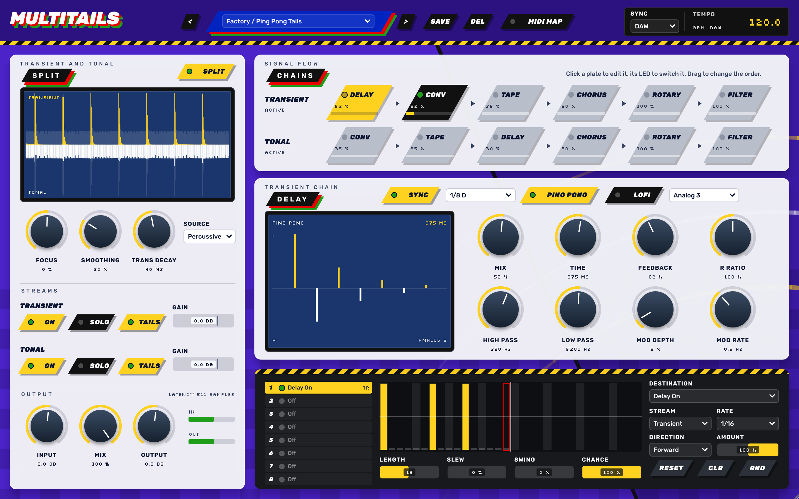
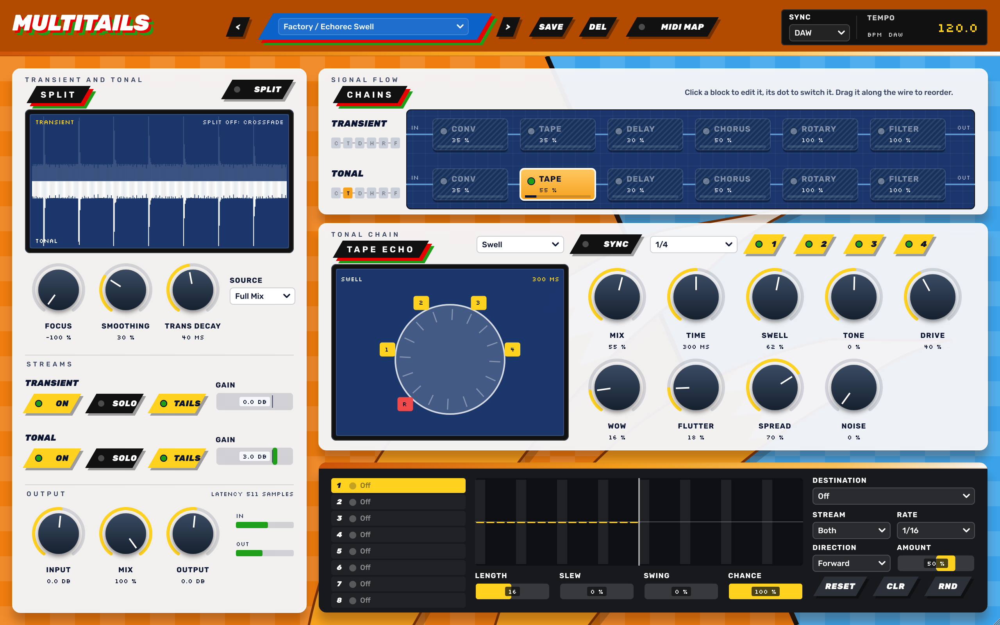
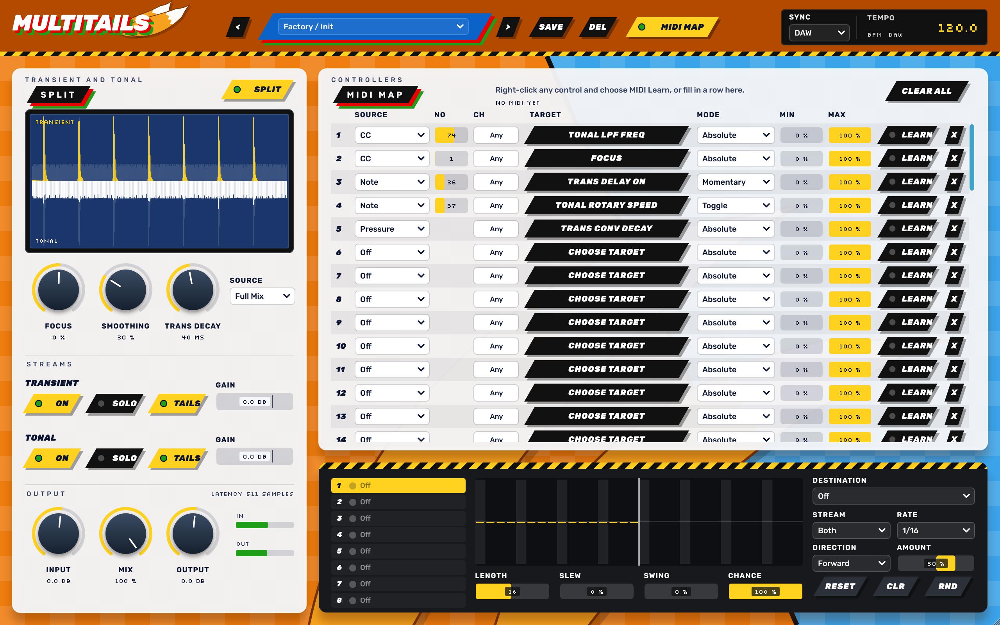

# MULTITAILS

Multieffetto a **due catene** in formato **VST3 / AU / AAX** (C++ / JUCE 8): separa il segnale in transiente e tonale e lavora su ciascuno con riverbero a convoluzione, tape echo, delay, chorus, rotary e filtri, in qualsiasi ordine. È il terzo della famiglia dopo [SONIC GRAIN](https://github.com/gianlucasofia90/SONICGRAIN) e [DR. SEGG-UENCER](https://github.com/gianlucasofia90/dr.segg-uencer): stessa grafica e stessa toolchain, qui su fondo arancione e azzurro con due code.

Il suono di riferimento resta quello di *Incunabula* e *Amber* degli Autechre e di *Selected Ambient Works 85-92* di Aphex Twin: colpi secchi lanciati in code digitali lunghe e granulose, nastro e chorus sulla parte tenuta, mandate che si aprono a tempo invece di un mix fisso. Su quei dischi il riverbero era quasi sempre un Alesis Quadraverb: da lì la famiglia `Digital` delle risposte all'impulso e l'idea della catena di effetti in serie.



| Tape echo | MIDI map |
|---|---|
|  |  |

## Come è fatto
```
             ┌─ TRANSIENT ─ [ 6 effetti in qualsiasi ordine ] ─ Gain ─┐
Input ─ SPLIT┤                                                        ├─ Mix ─ Output
             └─ TONAL ───── [ 6 effetti in qualsiasi ordine ] ─ Gain ─┘
```

## Split
Riferimento: Eventide Physion. Il segnale viene diviso in tempo e in frequenza: una parte dello spettro passa al flusso transiente quando la sua energia salta sopra la sua storia recente, e ci resta per il `Trans Decay`. Il flusso tonale è l'ingresso meno il flusso transiente, quindi senza effetti i due si risommano esattamente all'originale.

| Controllo | Cosa fa |
|---|---|
| **Focus** | Sposta l'energia verso il transiente (+) o il tonale (-). Agli estremi va tutto da una parte. |
| **Smoothing** | Rallenta i passaggi più rapidi tra i due flussi, per ridurre gli artefatti. |
| **Trans Decay** | Quanto a lungo una parte resta nel flusso transiente. |
| **Source** | Taratura per il materiale: Full Mix, Drums, Percussive, Keys, Vocal, Pad. |
| **SPLIT** | Spento, Focus diventa un semplice crossfade tra le due catene. Con Focus a -100 tutto passa da una catena sola. |

Ogni flusso ha `ON`, `SOLO`, `TAILS` e `GAIN`. Il display mostra l'ingresso in grigio, il transiente in giallo sopra la linea e il tonale in bianco sotto.

Lo split ha una latenza di una finestra, circa 10,6 ms (511 campioni a 48 kHz). Il plugin la dichiara all'host, che la compensa.

## La catena
Ogni riga ha sei piastre. Un clic apre l'effetto, un clic sul LED lo accende o lo spegne, trascinando si cambia l'ordine: per esempio `rev-chorus-tape` oppure `tape-chorus-rev`. Le due catene hanno ordini e impostazioni indipendenti.

**Tails**: quando un effetto si spegne si chiude la sua mandata, e quello che ha dentro continua a suonare fino alla fine. Con `TAILS` spento la coda si taglia insieme all'effetto.

## Effetti

### Convolution
Riverbero a convoluzione. La parte bagnata arriva 64 campioni dopo quella asciutta (1,3 ms).

- `Mix`, `Predelay`, `Width`, `Low Cut`, `High Cut`.
- `Decay` accorcia la coda della risposta, dal 100 % al 5 %. `Damp` toglie gli acuti man mano che la coda procede. Lavorano in tempo reale, quindi il sequencer può usarli per chiudere una coda a tempo. Con `Reverse` acceso non hanno effetto.
- `Size` allunga o accorcia la risposta dal 50 al 200 %, con il pitch che segue. `Reverse` la inverte. Questi due ricalcolano la risposta, con un crossfade.
- `LOAD IR`, o trascina un file sulla finestra: WAV, AIFF, FLAC, OGG, mono o stereo, fino a 20 s. Il percorso si salva con il progetto: il file non viene incorporato, e se manca il display lo segnala.

**Può emulare un plate?** Sì. Una lastra è un sistema quasi perfettamente lineare, quindi una risposta all'impulso ne cattura il suono, a differenza di un riverbero modulato. Le quattro risposte `Plate` non sono un'imitazione generica: sono calcolate simulando circa 19 500 modi di vibrazione di una lastra d'acciaio di 2 × 1 m e 0,5 mm, il formato dell'EMT 140, con due pickup. Ne escono da sole le caratteristiche della lastra: nessun tempo di salita, densità piena dal primo millisecondo, dispersione, bassi che durano più degli acuti. Quello che una risposta fissa non può fare è la modulazione lenta di una lastra sospesa: se serve, metti un `Chorus` leggero prima.

| Famiglia | Risposte | Origine |
|---|---|---|
| Plates | Short, Medium, Long, Bright | simulazione modale scritta per questo progetto |
| Digital | Hall, Room, Long, Gate, Reverse | rete di ritardi a bassa frequenza e 12-14 bit, nello spirito dei rack di fine anni '80 |
| Rooms | Tile Room, Living Room, Studio, Small, Large e Huge Hall, Church, Cathedral | database di HybridReverb2 (Ruhr-Universität Bochum, CC BY-SA 4.0); stanze simulate, non registrate |

Dettagli e attribuzioni in [Resources/ir/README.md](Resources/ir/README.md).

### Tape Echo
Riferimento: Binson Echorec. Una testina di registrazione e quattro di lettura equidistanti su una memoria rotante, un solo canale come sulla macchina.

- `Time` è il ritardo della testina 4, da 40 ms a 1,5 s (sull'originale erano circa 300 ms fissi), oppure a tempo con `SYNC`. Cambiandolo il pitch scivola, come con un motore vero.
- Le testine `1 2 3 4` si accendono una a una: le combinazioni fanno i pattern ritmici del selettore a 12 posizioni.
- `Echo`: un passaggio. `Repeat`: le testine accese rientrano in registrazione, `Swell` regola quanto; sopra il 100 % va in autooscillazione e la valvola la contiene. `Swell`: si aggiunge poco di tutte le testine, l'uso quasi da riverbero.
- `Tone`, `Drive` (valvola), `Wow` (legato al giro della memoria), `Flutter`, `Spread` (testine alternate a sinistra e destra), `Noise`.

La spaziatura uniforme delle testine è un'assunzione: non ho trovato una misura pubblicata in millisecondi.

### Delay
Riferimento: Waves H-Delay. Fino a 3,5 s, in millisecondi o a tempo.

- `Feedback` fino al 150 %: oltre il 100 % le ripetizioni crescono fino a un tetto morbido.
- `High Pass` e `Low Pass` nelle ripetizioni, `Mod Depth` e `Mod Rate` (triangolare), `R Ratio` per un tempo diverso sul canale destro.
- `PING PONG`, `LOFI` (banda stretta e 12 bit a 16 kHz, un delay digitale dei primi tempi), `Analog 1-4` (quattro gradi di saturazione e banda). Le mie Analog sono un'interpretazione: Waves non pubblica cosa fanno le sue.

### Chorus
Riferimento: Brainworx bx_bluechorus2, cioè il Boss CE-2. Una linea corta spazzata da un LFO triangolare, dentro la banda di un BBD. Il Mix parte al 50 %, come sul pedale.

- `Rate` da 0,05 a 12 Hz. Il CE-2 si ferma a circa 3,5 Hz: oltre si va verso il suono da altoparlante rotante.
- `Depth`, `Delay`, `Tone` (6,6 kHz come il CE-2), `Grit` (la sporcizia del BBD).
- `Mono` è il pedale, `Stereo` mette l'LFO in opposizione sui due lati, `Wide` aggiunge una seconda voce.

### Rotary
Emulazione Leslie: horn sopra gli 800 Hz, drum sotto.

- `Stop`, `Chorale` e `Tremolo`: horn a 50 e 400 giri, drum a 40 e 340.
- I due rotori hanno inerzia propria: l'horn arriva in un secondo circa, il drum ci mette diversi secondi. `Inertia` scala i tempi. Questi tempi sono una mia stima, non una misura.
- Effetto Doppler e ampiezza dell'horn sentiti da due microfoni, più il riflesso dal fondo del mobile. `Mic Angle` li apre, `Horn / Drum` bilancia, `Drive` è il preamplificatore a valvole.

### Filter
HPF, LPF e BPF in serie, ognuno con il suo interruttore.
- `HPF Freq`, `HPF Reso`, pendenza 12 o 24 dB.
- `LPF Freq`, `LPF Reso`, pendenza 12 o 24 dB.
- `BPF Freq`, `BPF Q`, `BPF Amount`.

Restano stabili mentre la frequenza si muove, anche a tempo di sequencer.

## Sequencer
Otto corsie che suonano insieme, ognuna fino a 32 passi, con la propria destinazione.

- **Destination**: quasi tutti i parametri degli effetti, gli interruttori, `Chain On`, `Split Focus`, `Transient Gain`, `Tonal Gain`, `Global Mix`. Fanno eccezione solo IR, Size e Reverse, che ricalcolano la risposta. **Stream**: Transient, Tonal o Both.
- **Rate**: da 4 bar a 1/64, puntate, terzine e ritmi `N:M` (5:1, 7:1 ...). **Length**: corsie di lunghezze diverse si spostano l'una sull'altra.
- **Direction**: Forward, Reverse, Pendulum, Random, Brownian. **Amount** (anche negativo), **Slew**, **Swing**, **Chance**.
- Sui parametri continui il passo si somma alla posizione della manopola: la manopola mostra l'arco del movimento. Sugli interruttori il passo in alto accende, quello in basso spegne. Sui menu il passo sceglie la voce.
- Si disegna trascinando, il tasto destro azzera un passo. `RND` riempie la corsia, `CLR` la svuota, `RESET` torna al passo 1.

Con Sync su **DAW** il sequencer segue la posizione del trasporto, e a trasporto fermo le corsie restano dove sono. Con **FREE** usa il suo BPM e il tasto RUN, anche a trasporto fermo. I tempi `SYNC` di tape e delay seguono lo stesso clock.

Tasto destro su un controllo → `Send to sequencer` lo assegna a una corsia.

## MIDI map
Il pulsante `MIDI MAP` apre 64 righe. Ogni riga collega una sorgente (CC, nota, pitch bend, pressure) a qualsiasi parametro del plugin.

- **Learn**: tasto destro su un controllo → `MIDI Learn`, poi muovi il controller. Oppure compila la riga e usa `LEARN`.
- **Mode**: `Absolute`, `Toggle`, `Momentary` (acceso finché tieni), `Relative` (encoder).
- **Min** e **Max** limitano l'escursione. Con Min sopra Max il controllo si inverte.
- La mappa si salva con il progetto, non nei preset, perché dipende dai tuoi controller.

### Uso in Ableton Live
Il plugin è un effetto audio che accetta MIDI. Per fargli arrivare il MIDI: su una traccia MIDI, in `MIDI To`, scegli la traccia di MULTITAILS e poi `MULTITAILS` nel menu sotto. Lo stesso vale per un controller: la traccia MIDI deve avere `Monitor` su `In`. I parametri si possono anche mappare con il MIDI Map di Live, come quelli di ogni plugin. Questo percorso non è ancora stato provato su Live: vedi Stato.

## Preset
`Init`, `Amber Halls`, `Incunabula Plate`, `Ambient Works Tape`, `Echorec Swell`, `Echorec Heads`, `EMT Plate`, `Gated Snare`, `Reverse Ghosts`, `Leslie Ramp`, `Rotary Keys`, `Filter Steps`, `Ping Pong Tails`, `Cathedral Wash`, `LoFi Dub Hits`. Sono punti di partenza ispirati a quei dischi, non ricostruzioni. I preset utente stanno in `~/Music/Multitails Presets/*.mtails`.

## Stato
Verificato su macOS, Windows e Linux in CI: 312 test automatici (DSP misurato, sequencer, MIDI map, stato, interfaccia) e pluginval livello 8, più auval su macOS. Da verificare: l'ascolto e l'uso reale in Ableton Live, compreso il MIDI verso un effetto.

## Download
Ogni tag `v*` pubblica una Release con:
- macOS: installer `.pkg` con VST3 e AU, oppure VST3, AU e AAX non firmato in zip (universal arm64 + x86_64, da macOS 11);
- Windows: VST3;
- Linux: VST3.

**macOS**: le build non sono firmate con un Developer ID né notarizzate, quindi macOS le blocca come file scaricati da internet. Il modo più semplice è l'installer:
1. Scarica `Multitails-…-macOS-Installer.pkg` e aprilo. macOS lo blocca.
2. Vai in Impostazioni di Sistema → Privacy e sicurezza, premi `Apri comunque` e completa l'installazione.
3. In Live fai una nuova scansione dei plugin: in Impostazioni → Plug-in tieni premuto Option e premi `Scansiona`.

L'approvazione serve una volta sola per il pacchetto: i plugin installati non hanno la quarantena. Vanno in `/Library/Audio/Plug-Ins/VST3` e `/Library/Audio/Plug-Ins/Components`. Se avevi copiato a mano una versione precedente in `~/Library/Audio/Plug-Ins`, cancellala.

Se preferisci gli zip, dopo aver copiato i plugin togli la quarantena dal Terminale, perché `Apri comunque` può non bastare per un VST3:
```bash
xattr -dr com.apple.quarantine ~/Library/Audio/Plug-Ins/VST3/"MULTITAILS.vst3" ~/Library/Audio/Plug-Ins/Components/"MULTITAILS.component"
```

**AAX**: Pro Tools carica nella versione normale solo plugin firmati con PACE, come per gli altri due.

**VST2**: non viene compilato di default, perché lo SDK Steinberg non è più distribuito. Se hai una copia con licenza: `-DMULTITAILS_VST2_SDK=/percorso/vstsdk2.4`.

## Compilare
Servono CMake ≥ 3.22, un compilatore C++17 e git. JUCE 8.0.10 viene scaricato in automatico; per usarne una copia locale aggiungi `-DJUCE_DIR=/percorso/JUCE`.

```bash
cmake -B build -DCMAKE_BUILD_TYPE=Release            # -DMULTITAILS_BUILD_AAX=ON  -DMULTITAILS_BUILD_TESTS=ON
cmake --build build --config Release
```
- I plugin vengono copiati nelle cartelle plug-in dell'utente (si disattiva con `-DMULTITAILS_COPY_AFTER_BUILD=OFF`).
- **Mac senza Terminale**: doppio clic su `scripts/build-mac.command`, poi `scripts/verify-au.command` per auval.

### Pubblicare una versione
Doppio clic su `scripts/release.bat` (Windows) o `scripts/release.command` (macOS): aggiorna la versione in `CMakeLists.txt`, aggiunge la voce nel CHANGELOG se manca, fa push e crea il tag `vX.Y.Z`. La CI pubblica la Release.

### Test
```bash
cmake -B build -DMULTITAILS_BUILD_TESTS=ON && cmake --build build --config Release
build/Tests/MultitailsTests_artefacts/Release/MultitailsTests
build/Tests/MultitailsTests_artefacts/Release/MultitailsTests --snap snap.png 0 1 2 3 2   # pagina, flusso, effetto, preset, scala
build/Tests/MultitailsTests_artefacts/Release/MultitailsTests --render out.wav 3 20       # frase di prova, preset, secondi
```

## Struttura
| Percorso | Contenuto |
|---|---|
| `Source/TailsCore.h` | tabelle: effetti, parametri, divisioni, ordine della catena |
| `Source/TailsConv.h` | FFT e convoluzione a partizioni |
| `Source/TailsSplit.h` | split transiente/tonale |
| `Source/TailsFx.h` | tape, delay, chorus, rotary, filtri |
| `Source/TailsEngine.h` | catene, sequencer, controllo a 32 campioni |
| `Source/MidiMap.h` | tabella e logica della MIDI map |
| `Source/TailsProcessor.*` | parametri, trasporto, IR, stato, preset |
| `Source/TailsUI.h`, `Source/TailsEditor.h` | grafica e layout |
| `tools/make_irs.py` | genera le risposte all'impulso di fabbrica |
| `Tests/` | test headless, snapshot dell'editor, render audio |

## Licenza
JUCE 8 è distribuito sotto AGPLv3 o licenza commerciale. Per distribuire i binari serve una licenza JUCE commerciale, oppure rilasciare questo codice sotto AGPLv3. Le 8 risposte `Rooms` sono CC BY-SA 4.0. I font sono SIL Open Font License. VST è un marchio di Steinberg Media Technologies GmbH. Echorec, H-Delay, bx_bluechorus2, CE-2, Leslie, EMT, Physion e Quadraverb sono marchi dei rispettivi proprietari, citati solo come riferimento: MULTITAILS non è affiliato a nessuno di loro.
